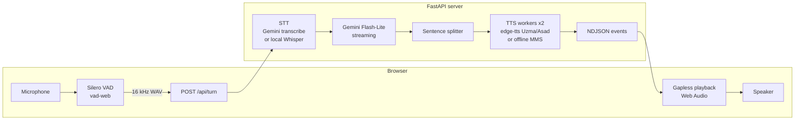

# Urdu Voice Agent

Speak Urdu in your browser and get a spoken Urdu answer: speech detection in the browser,
Gemini for listening and thinking, a neural Pakistani Urdu voice for speaking, streamed
sentence by sentence. Runs on an ordinary laptop CPU, or on a free cloud host.

## Demo

> TODO (owner): add a screen recording as `docs/demo.gif` and the live link.


**Live demo:** `<your-render-url>` (free tier: the first visit after a quiet period takes
about a minute to wake up).

## Features

- **Hands-free conversation.** Silero VAD runs in the browser (`@ricky0123/vad-web`) and ends
  your turn after ~0.8 s of silence; a loudness-based detector takes over if it can't load.
- **Fast, accurate listening.** Gemini audio transcription (`gemini-3.5-transcribe`, ~1.5-2.6 s
  per turn), with automatic fallback to local `faster-whisper` (`small`, ~3-4 s) when offline
  or out of quota.
- **Streaming replies.** Gemini Flash-Lite streams the answer; each sentence is voiced as soon
  as it is complete, so the first words play while the rest is still being written.
- **Natural Urdu voice.** Microsoft neural voices Uzma (female) and Asad (male) via edge-tts,
  with an offline Meta MMS voice as fallback. Persona grammar (سکتی / سکتا) follows the voice.
- **Urdu text normalization.** Markdown, emojis, links and Latin words are stripped before
  speech; numbers become Urdu words (1234 → ایک ہزار دو سو چونتیس, phone numbers digit by
  digit, `Rs 500` → پانچ سو روپے).
- **Simple everyday Urdu.** The prompt asks for short, direct, spoken-style answers with common
  words, no filler, no greeting.
- **Ready for a public link.** One conversation per browser tab, per-IP and global rate limits,
  upload/length caps, security headers, and a cloud mode without torch or local models.
- **Two front ends.** A browser app (animated voice orb, live captions, latency chips, dark
  mode, phone layout) and a console loop that uses the laptop mic directly.

## Architecture



`POST /api/turn` (an audio upload) and `POST /api/chat` (typed text) answer with a stream of
newline-delimited JSON events, so the page can react to each stage as it happens:

| Event | Meaning |
|---|---|
| `heard` | what the user said (shown immediately) |
| `reply_text` | one sentence of the answer, as Gemini writes it |
| `audio` | base64 MP3/WAV for that sentence, delivered in order |
| `done` | full reply plus per-stage timings |
| `not_heard` / `error` | nothing understood, or a friendly error (e.g. daily limit) |

Only the Gemini call is serialized; two TTS workers voice sentences in parallel with the
stream. Closing the request (barge-in, New chat) cancels Gemini and the voice.

## Performance

Measured on the development laptop (Intel i7-8550U, 4 cores, no GPU, ~0.65 MB/s internet),
free-tier Gemini.

**Time from sending a typed message to the first spoken word**

| | Short question | Longer question |
|---|---|---|
| Before (wait for the whole reply, then voice it) | 8.9-13.6 s | 13.6-16.7 s |
| After (streaming, sentence by sentence) | 2.4-5.0 s | 3.1-5.8 s |

Occasional outliers (10-35 s) come from Gemini 503s and edge-tts dropping a request, which
then falls back to the offline voice. A spoken turn adds the listening time below.

**Listening (speech-to-text)**

| Option | CER (synthetic) | WER (synthetic) | Seconds per turn |
|---|---|---|---|
| Gemini `gemini-3.1-flash-lite` | 0 % | 0 % | 2.5 |
| Gemini `gemini-3.5-transcribe` | spot checks correct | | 1.5-2.6 |
| Whisper `small`, beam 5 (local) | 11 % | 18 % | 3.2 |
| Whisper `medium`, beam 5 (local) | 5 % | 14 % | 11.0 |

CER/WER are character/word error rates on 6 clips of everyday Urdu synthesized with the
Uzma and Asad voices (a noisy copy gave Whisper `small` 14 % / 30 %). Synthetic speech
flatters every model and the real-voice set is a single clip, so treat these as relative,
not absolute. Record your own set with `python -m scripts.record_samples` and re-run
`python -m scripts.benchmark_stt --sets real`.

Whisper `medium` was the starting point; it was too slow for conversation on this CPU,
which is what drove the move to Gemini transcription with `small` as the offline fallback.

## Tech stack

| Layer | Tools |
|---|---|
| Browser | Vanilla HTML/CSS/JS, Web Audio, `@ricky0123/vad-web` (Silero VAD on ONNX Runtime Web) |
| Server | Python 3.11, FastAPI, Uvicorn, NDJSON streaming |
| Listening | Gemini (`google-genai`), `faster-whisper` (CTranslate2, int8 CPU), Silero VAD |
| Thinking | Gemini 3.1 Flash-Lite, falling back to 3.5 Flash-Lite and 3.5 Flash |
| Speaking | `edge-tts` (ur-PK-UzmaNeural / ur-PK-AsadNeural), Meta MMS-TTS Urdu (Transformers) |
| Quality | pytest (83 tests), ruff |
| Deploy | Docker, Render blueprint |

## Quick start (Windows)

You need Python 3.11 and a free Gemini API key from https://aistudio.google.com/apikey.

```powershell
git clone https://github.com/<your-user>/urdu-voice-agent.git
cd urdu-voice-agent
py -3.11 -m venv .venv
.venv\Scripts\activate
python -m pip install --upgrade pip
pip install -r requirements.txt        # CPU build of torch; see the file for GPU
copy .env.example .env                 # then put your GEMINI_API_KEY in .env
```

Then double-click **`start.bat`**. The server loads the models (~20 s) and opens
http://127.0.0.1:7860. Tap the orb, allow the microphone and speak Urdu. Keep the console
window open while you talk.

`tools.bat` has the developer menu: the console voice loop and per-component tests
(`python -m scripts.test_tts`, `test_llm`, `test_stt`).

Models download into `models/` on first use (Whisper `small` ~480 MB, MMS ~145 MB).

## Configuration

All settings live in `.env` (template: `.env.example`).

| Variable | Local (laptop) | Cloud (public link) |
|---|---|---|
| `APP_MODE` | `local` | `cloud` |
| `GEMINI_MODEL` | `gemini-3.1-flash-lite` | same |
| `GEMINI_FALLBACK_MODELS` | `gemini-3.5-flash-lite,gemini-3.5-flash` | same |
| `GEMINI_THINKING_LEVEL` | `MINIMAL` | same |
| `STT_BACKEND` | `gemini` | `gemini` |
| `GEMINI_STT_MODEL` | `gemini-3.5-transcribe,gemini-3.1-flash-lite` | same |
| `STT_FALLBACK` | `whisper` (offline Whisper `small`) | `none` |
| `TTS_BACKEND` / `TTS_VOICE` | `edge` / `ur-PK-UzmaNeural` | same |
| `AGENT_GENDER` | `female` (match the voice) | same |
| `RATE_LIMIT_PER_MINUTE` / `_PER_DAY` / `DAILY_TURN_LIMIT` | off | 8 / 30 / 100 |
| `TRUST_PROXY` | `0` | `1` (behind Render's proxy) |

## Deploy

The backend is a long-running Python process that streams responses, so it runs as one free
**Render** web service from the included `Dockerfile` and `render.yaml` (Vercel's serverless
functions don't fit that model). The page and API are served from the same address, which also
gives the HTTPS browsers require for the microphone. Cloud mode installs
`requirements-cloud.txt` only (~200 MB, no torch) and keeps the API key server-side.

Step-by-step: [docs/DEPLOY.md](docs/DEPLOY.md).

## Project structure

```
src/
  server.py      FastAPI app: page, NDJSON endpoints, sessions, security headers
  pipeline.py    Conversation core: hear -> stream reply -> voice sentences; console loop
  stt.py         Gemini transcription, faster-whisper, fallback chain
  llm.py         Gemini chat: Urdu system prompt, streaming, retries, model fallback
  tts.py         edge-tts and MMS voices, fallback, encoded audio for the browser
  text_utils.py  Urdu normalization, numbers to words, sentence splitting
  limits.py      per-IP and global rate limits
  vad.py         Silero VAD (local mode)
  audio_io.py    mic, speaker, WAV helpers
  config.py      settings from .env
web/index.html   browser app (single file, no build step)
scripts/         console loop, component tests, STT benchmark, sample recorder
tests/           pytest suite
benchmarks/      benchmark sentences and results
docs/            deploy guide, research notes
```

## Testing

```powershell
.venv\Scripts\python.exe -m pytest -q      # 83 tests, no network or mic needed
.venv\Scripts\python.exe -m ruff check src scripts tests
```

## Limitations and roadmap

- **Free-tier quota is the ceiling.** Google's free tier allows about 20-25 requests per day
  per model, and a spoken turn uses two (listening + answer). The app spreads load over
  fallback models and shows a friendly "daily limit reached" message; a paid key removes it.
- **edge-tts is an unofficial online service.** It occasionally drops a request; the app
  retries once and then uses the offline MMS voice (robotic, but it keeps talking).
- **Free Render instances sleep** after ~15 minutes idle and take about a minute to wake.
- **Interrupting by voice is off by default** because, without headphones, the mic can pick
  up the agent's own voice. Tapping the orb interrupts instantly.
- Ideas: send audio straight to the chat model in one call (halves latency and quota), a local
  Piper Urdu voice, an Urdu fine-tuned Whisper converted to CTranslate2, a real-voice
  benchmark set.

## Credits

[faster-whisper](https://github.com/SYSTRAN/faster-whisper),
[Silero VAD](https://github.com/snakers4/silero-vad),
[vad-web](https://github.com/ricky0123/vad),
[edge-tts](https://github.com/rany2/edge-tts),
[Meta MMS-TTS](https://huggingface.co/facebook/mms-tts-urd-script_arabic),
[Gemini API](https://ai.google.dev/). Design choices (turn-taking, latency targets,
streaming pattern) are based on the sources collected in [docs/research.md](docs/research.md).

## License

[MIT](LICENSE)
